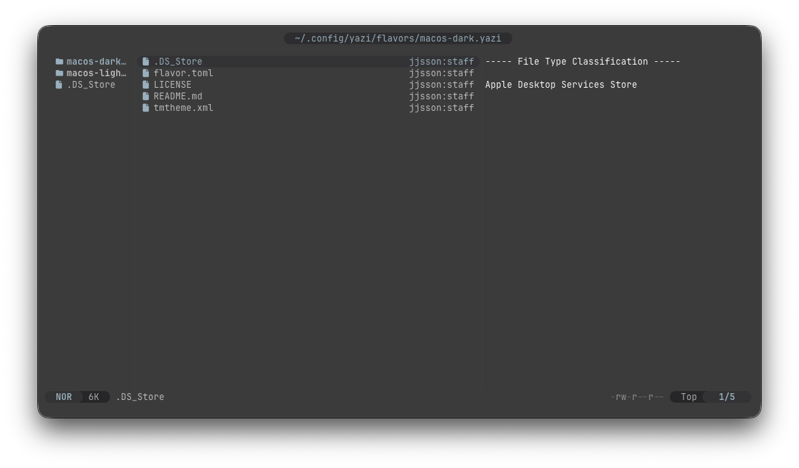

<div align="center">
  <h1>macOS Dark Flavor for <a href="https://github.com/sxyazi/yazi">Yazi</a></h1>
</div>

A Finder-inspired dark flavor for Yazi: grayscale text only, `#a4b9c6` for active text, and pill-shaped tabs and status bar segments.

## Preview



## Requirements

A recent Yazi release with flavor support and a [Nerd Font](https://www.nerdfonts.com/) in your terminal, which draws the rounded pill ends.

## Installation

```sh
ya pkg add <your-github-user>/<your-repo>:macos-dark
```

Or copy this folder to `~/.config/yazi/flavors/macos-dark.yazi/`.

## Usage

Add this to `~/.config/yazi/theme.toml`:

```toml
[flavor]
dark = "macos-dark"
```

To follow the system appearance, use both flavors:

```toml
[flavor]
dark  = "macos-dark"
light = "macos-light"
```

## Palette

| Role | Color |
|------|-------|
| Background | `#1e1e1e` |
| Text | `#e6e6e6` |
| Secondary text | `#98989d` |
| Active text | `#a4b9c6` |
| Selection and pills | `#3a3a3c` |
| Borders | `#48484a` |

## License

Released under the MIT License. See [LICENSE](LICENSE).
